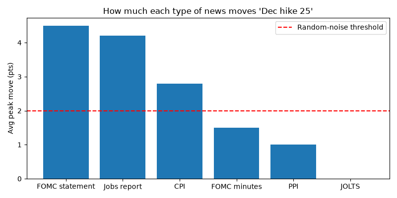

# polybot

**How fast do prediction markets price macroeconomic news, and can a small market-maker profit by knowing when to step aside?**

polybot records Polymarket's Fed-decision markets alongside official Federal Reserve and BLS releases, measures how prices react to each release, tests those reactions against a placebo baseline, and uses the results to drive a news-aware market-making simulator.



---

## Key findings

*Market studied: "Will the Fed increase interest rates by 25 bps after the December 2026 meeting?" Releases from Aug–Nov 2026. Price data at 1-minute resolution.*

### 1. Markets reprice economic data within 2–3 minutes

| Release type | Events | Significant* | Avg move (pts) | Mins to peak | Reversal within 1h |
|---|---|---|---|---|---|
| FOMC statement | 1 | 1/1 | 4.5 | 8.0 | 67% |
| Jobs report | 4 | 2/4 | 4.2 | 2.5 | 40% |
| CPI | 4 | 2/4 | 2.8 | 3.0 | 38% |
| FOMC minutes | 2 | 1/2 | 1.5 | 3.0 | 67% |
| PPI | 4 | 1/4 | 1.0 | 21.0 | 33% |
| JOLTS | 4 | 0/4 | 0.0 | – | – |

\*Significant = peak move larger than 95% of moves at 300 random no-news moments (placebo test).

- **Jobs and CPI data are priced fastest** (2–3 minutes to peak). Fed statements take longer (~8 minutes), likely because text takes longer to interpret than a number.
- **Fed communications overshoot more** (~67% of the move reverses within an hour) than data releases (~40%).
- **Traders ignore secondary data:** JOLTS produced no significant reaction in 4 of 4 releases.
- **Direction matches economics:** a weak jobs report (+29k) cut hike odds by 5 points; a strong one (+165k) raised them by 10.

### 2. The moves are real, not noise

At random moments with no news, the market's median 30-minute move is **0 points** and its 95th percentile is **2 points**. **7 of 10** recent releases moved the market more than 99% of random moments.

### 3. Trading the news after it breaks doesn't pay

A momentum strategy (enter 2 minutes after a release in the direction of the move) went **0 for 6** and lost money even before costs. By minute 2 the market has already priced the news. Directional trading at retail speed has no edge here.

### 4. A news-aware market-maker was profitable in simulation

Replaying **~23,700 real trades** (Oct 1 – Nov 20, 2026) across two Fed-decision markets:

| Strategy | Dec hike 25 | Dec no change | Total | Peak inventory |
|---|---|---|---|---|
| Always quoting | −$1.68 | +$13.62 | +$11.94 | 100 shares |
| + step aside 5 min before → 30 min after releases | +$0.03 | +$15.33 | +$15.36 | 100 shares |
| + inventory skew (1¢) | **+$16.79** | **+$9.32** | **+$26.11** | **33–46 shares** |

*Quotes 10 shares at ±1¢ around the last trade; assumes 10% of each crossing trade fills against the bot.*

- **Stepping aside around releases** improved P&L in both markets.
- **Inventory skew** fixed the losing market (the bot stopped accumulating a position against a 60%→90% trend) and cut peak inventory by more than half.
- **Robust to assumptions:** profitable in every sensitivity case tested (fill share 5–20%, spread 1–2¢).

---

## Method

1. **Data collection:** `record.py` snapshots prices, best bid/ask and volume for ~200 economics markets every 15 seconds. `news.py` polls Federal Reserve and BLS (CPI, jobs, PPI, JOLTS) feeds and timestamps each new release.
2. **Event study:** `batch_study.py` pulls 1-minute price history around each release and measures move size, time to peak and intra-hour reversal. BLS releases are aligned to their official 8:30 AM ET release time.
3. **Placebo test:** `placebo.py` computes the same statistics at 300 random no-news moments during US trading hours to establish a noise baseline.
4. **Strategy tests:** `backtest.py` tests directional strategies; `mm_sim2.py` and `mm_sim3.py` replay real trade history through a market-making simulator with event-based quote pulling and inventory skew.

---

## Limitations

- **Small samples.** 1–4 events per release type. These are early findings, not conclusions.
- **One family of markets.** All results come from December Fed-decision markets.
- **In-sample.** Strategy parameters were chosen on the same data they were tested on. See below for the out-of-sample test.
- **Fill model is the biggest unknown.** The simulator assumes a fixed share of each crossing trade fills against the bot. Real queue position and competing market-makers could change results either way.
- **Fees and liquidity rewards are not modeled.**
- **1-minute price resolution.** "2 minutes to peak" may mean "within the first minute."

---

## Out-of-sample test

To guard against overfitting, a reversal hypothesis was **pre-registered** in [`HYPOTHESIS.md`](HYPOTHESIS.md) before December 2026's releases. Its commit timestamp proves the rule was fixed before the test data existed. Results will be added here after the December jobs report, CPI release and FOMC decision.

---

## Project structure

| File | Purpose |
|---|---|
| `record.py` | Live price recorder (economics markets + top 50 by volume) |
| `news.py` | Live Fed/BLS release watcher |
| `filters.py` | Rules for which releases are market-moving |
| `batch_study.py` | Event study across all releases |
| `placebo.py` | Random no-news baseline and significance test |
| `summary.py` | Results by release type + summary chart |
| `backtest.py` | Directional strategy backtest |
| `mm_sim2.py` / `mm_sim3.py` | Trade-replay market-making simulator, inventory skew, sensitivity |
| `HYPOTHESIS.md` | Pre-registered out-of-sample hypothesis |

## Running it

```bash
python3 -m venv venv && source venv/bin/activate
pip install requests pandas feedparser matplotlib
python record.py      # terminal 1: price recorder
python news.py        # terminal 2: news watcher
python batch_study.py && python placebo.py && python summary.py
python mm_sim3.py
```

## Roadmap

- [x] Live price and news collection
- [x] Event study with placebo baseline
- [x] Trade-replay market-making simulator with news protection and inventory skew
- [ ] Out-of-sample test on December 2026 releases
- [ ] Live paper trading
- [ ] Extend to January/March decision markets and cross-venue (Kalshi) comparison

---

*Research project. Not financial advice. Uses only public Polymarket, Federal Reserve and BLS data.*